<p align="center">
  <picture>
    <source media="(prefers-color-scheme: dark)" srcset="assets/hero-dark.svg">
    <source media="(prefers-color-scheme: light)" srcset="assets/hero-light.svg">
    
  </picture>
</p>

<h1 align="center">aws-cost-audit</h1>

<p align="center">
  <a href="LICENSE"></a>
  <a href="https://github.com/Aboudjem/aws-cost-audit-skill/actions/workflows/validate.yml"></a>
  <a href="https://github.com/Aboudjem/10x"></a>
</p>

<p align="center">
  <b>English</b> · <a href="READMEs/zh-CN.md">简体中文</a> · <a href="READMEs/ja.md">日本語</a> · <a href="READMEs/es.md">Español</a> · <a href="READMEs/fr.md">Français</a>
</p>

<p align="center"><strong>Find what to stop paying for on your AWS bill.</strong></p>

<p align="center">Your agent reads your AWS account and ranks what to cut.</p>

| Lower AWS bill | Prices checked against AWS | Rollback before any change |
|:--|:--|:--|
| Each report opens with a dollar verdict and the three cuts to make first. | Each price records its AWS lookup. `make test` shows a figure without one is rejected. | Scripts dry run by default. `--apply` saves a rollback file first, then asks, unless `--yes`. |

**Works with:** any agent that reads skills. Install tested: Claude Code, Codex, Cursor, Gemini CLI, GitHub Copilot, OpenCode.
It is Markdown and bash, so it is not tied to one model.

```bash
npx skills add Aboudjem/aws-cost-audit-skill -g -a claude-code -y
# give it read-only AWS credentials, then ask your agent: audit my AWS bill
```

This installs for all your projects. Other agents and the Claude Code plugin are under [Install](#install).

It is a skill for your AI agent, with scripts that read your AWS account.
Use it when your bill grows and you do not know why.

You get a ranked list of cuts. Each one shows its evidence and where its price came from.

## Sample report

Every report opens like this. This one is an illustration: a fictional account, invented figures, no real AWS data.
<!-- sample-report:begin -->

```text
VERDICT: save $242/mo now, safely. Up to $1,777/mo with sign-offs.
11 findings to act on: 4 safe now, 7 need sign-off. 1 to keep.

Do these three first:
1. OPTIMIZE 9 log groups that never expire (Amazon CloudWatch Logs, us-east-1): saves $84/mo. High confidence, reversible.
2. SAFE-TO-DELETE 4 unattached EBS volumes (vol-EXAMPLE1 to vol-EXAMPLE4) (Amazon EBS, us-east-1): saves $72/mo. High confidence, reversible.
3. OPTIMIZE abandoned multipart uploads in <demo-bucket> (Amazon S3, us-east-1): saves $58/mo. High confidence, reversible.

Detail:
- Save now safely: 4 findings, $242/mo
- Needs sign-off: 7 findings, $1,535/mo
- No verified cost: 0 findings, in no total
- Keep: 1 finding
- Price sources: 9 Price List lookups, 4 Cost Explorer reads
Re-check the Price List prices live: verify-price.sh --recheck examples/sample-findings.json
Every figure above comes from the findings file. Nothing in your account was changed.
```

<!-- sample-report:end -->

Re-print it with `bash skills/aws-cost-audit/scripts/findings-summary.sh examples/sample-findings.json`.

It needs the AWS CLI, `jq` and Cost Explorer. New Cost Explorer data can take 24 hours to appear.

## Install

**Pick your agent.** Each command installs for all your projects.

[](#claude-code) [![Codex](https://img.shields.io/badge/Codex-000000?style=for-the-badge&logo=data%3Aimage%2Fsvg%2Bxml%3Bbase64%2CPHN2ZyBmaWxsPSJ3aGl0ZSIgcm9sZT0iaW1nIiB2aWV3Qm94PSIwIDAgMjQgMjQiIHhtbG5zPSJodHRwOi8vd3d3LnczLm9yZy8yMDAwL3N2ZyI%2BPHRpdGxlPk9wZW5BSTwvdGl0bGU%2BPHBhdGggZD0iTTIyLjI4MTkgOS44MjExYTUuOTg0NyA1Ljk4NDcgMCAwIDAtLjUxNTctNC45MTA4IDYuMDQ2MiA2LjA0NjIgMCAwIDAtNi41MDk4LTIuOUE2LjA2NTEgNi4wNjUxIDAgMCAwIDQuOTgwNyA0LjE4MThhNS45ODQ3IDUuOTg0NyAwIDAgMC0zLjk5NzcgMi45IDYuMDQ2MiA2LjA0NjIgMCAwIDAgLjc0MjcgNy4wOTY2IDUuOTggNS45OCAwIDAgMCAuNTExIDQuOTEwNyA2LjA1MSA2LjA1MSAwIDAgMCA2LjUxNDYgMi45MDAxQTUuOTg0NyA1Ljk4NDcgMCAwIDAgMTMuMjU5OSAyNGE2LjA1NTcgNi4wNTU3IDAgMCAwIDUuNzcxOC00LjIwNTggNS45ODk0IDUuOTg5NCAwIDAgMCAzLjk5NzctMi45MDAxIDYuMDU1NyA2LjA1NTcgMCAwIDAtLjc0NzUtNy4wNzI5em0tOS4wMjIgMTIuNjA4MWE0LjQ3NTUgNC40NzU1IDAgMCAxLTIuODc2NC0xLjA0MDhsLjE0MTktLjA4MDQgNC43NzgzLTIuNzU4MmEuNzk0OC43OTQ4IDAgMCAwIC4zOTI3LS42ODEzdi02LjczNjlsMi4wMiAxLjE2ODZhLjA3MS4wNzEgMCAwIDEgLjAzOC4wNTJ2NS41ODI2YTQuNTA0IDQuNTA0IDAgMCAxLTQuNDk0NSA0LjQ5NDR6bS05LjY2MDctNC4xMjU0YTQuNDcwOCA0LjQ3MDggMCAwIDEtLjUzNDYtMy4wMTM3bC4xNDIuMDg1MiA0Ljc4MyAyLjc1ODJhLjc3MTIuNzcxMiAwIDAgMCAuNzgwNiAwbDUuODQyOC0zLjM2ODV2Mi4zMzI0YS4wODA0LjA4MDQgMCAwIDEtLjAzMzIuMDYxNUw5Ljc0IDE5Ljk1MDJhNC40OTkyIDQuNDk5MiAwIDAgMS02LjE0MDgtMS42NDY0ek0yLjM0MDggNy44OTU2YTQuNDg1IDQuNDg1IDAgMCAxIDIuMzY1NS0xLjk3MjhWMTEuNmEuNzY2NC43NjY0IDAgMCAwIC4zODc5LjY3NjVsNS44MTQ0IDMuMzU0My0yLjAyMDEgMS4xNjg1YS4wNzU3LjA3NTcgMCAwIDEtLjA3MSAwbC00LjgzMDMtMi43ODY1QTQuNTA0IDQuNTA0IDAgMCAxIDIuMzQwOCA3Ljg3MnptMTYuNTk2MyAzLjg1NThMMTMuMTAzOCA4LjM2NCAxNS4xMTkyIDcuMmEuMDc1Ny4wNzU3IDAgMCAxIC4wNzEgMGw0LjgzMDMgMi43OTEzYTQuNDk0NCA0LjQ5NDQgMCAwIDEtLjY3NjUgOC4xMDQydi01LjY3NzJhLjc5Ljc5IDAgMCAwLS40MDctLjY2N3ptMi4wMTA3LTMuMDIzMWwtLjE0Mi0uMDg1Mi00Ljc3MzUtMi43ODE4YS43NzU5Ljc3NTkgMCAwIDAtLjc4NTQgMEw5LjQwOSA5LjIyOTdWNi44OTc0YS4wNjYyLjA2NjIgMCAwIDEgLjAyODQtLjA2MTVsNC44MzAzLTIuNzg2NmE0LjQ5OTIgNC40OTkyIDAgMCAxIDYuNjgwMiA0LjY2ek04LjMwNjUgMTIuODYzbC0yLjAyLTEuMTYzOGEuMDgwNC4wODA0IDAgMCAxLS4wMzgtLjA1NjdWNi4wNzQyYTQuNDk5MiA0LjQ5OTIgMCAwIDEgNy4zNzU3LTMuNDUzN2wtLjE0Mi4wODA1TDguNzA0IDUuNDU5YS43OTQ4Ljc5NDggMCAwIDAtLjM5MjcuNjgxM3ptMS4wOTc2LTIuMzY1NGwyLjYwMi0xLjQ5OTggMi42MDY5IDEuNDk5OHYyLjk5OTRsLTIuNTk3NCAxLjQ5OTctMi42MDY3LTEuNDk5N1oiLz48L3N2Zz4%3D)](#codex) [](#cursor) [](#gemini-cli) [](#github-copilot) [](#opencode)

### Claude Code

Install tested. Add the plugin from the [10x marketplace](https://github.com/Aboudjem/10x). It installs for your user, in every project.

```bash
claude plugin marketplace add Aboudjem/10x
claude plugin install aws-cost-audit@10x
```

Or as a skill: `npx skills add Aboudjem/aws-cost-audit-skill -g -a claude-code -y`.

### Codex

Install tested.

```bash
npx skills add Aboudjem/aws-cost-audit-skill -g -a codex -y
```

### Cursor

Install tested.

```bash
npx skills add Aboudjem/aws-cost-audit-skill -g -a cursor -y
```

### Gemini CLI

Install tested.

```bash
npx skills add Aboudjem/aws-cost-audit-skill -g -a gemini-cli -y
```

### GitHub Copilot

Install tested.

```bash
npx skills add Aboudjem/aws-cost-audit-skill -g -a github-copilot -y
```

### OpenCode

Install tested.

```bash
npx skills add Aboudjem/aws-cost-audit-skill -g -a opencode -y
```

Only this project: drop `-g`. Another agent: put its code after `-a`. Without `-a`, the installer asks.

### What it needs

1. The [AWS CLI](https://aws.amazon.com/cli/) v2 with read access to the account, and `jq`.
2. Read-only rights: the AWS managed `ReadOnlyAccess` policy plus billing read (`ce:Get*`, `pricing:GetProducts`).
3. Then ask your agent: `audit my AWS bill`. It checks your setup first and names anything missing.

### Works with

| Agent                | Install command (all your projects)                                     | Install tested |
| :------------------- | :---------------------------------------------------------------------- | :------------- |
| Claude Code (plugin) | `claude plugin install aws-cost-audit@10x`                              | 2026-11-17     |
| Claude Code (skill)  | `npx skills add Aboudjem/aws-cost-audit-skill -g -a claude-code -y`    | 2026-11-17     |
| Codex                | `npx skills add Aboudjem/aws-cost-audit-skill -g -a codex -y`          | 2026-11-17     |
| Cursor               | `npx skills add Aboudjem/aws-cost-audit-skill -g -a cursor -y`         | 2026-11-17     |
| Gemini CLI           | `npx skills add Aboudjem/aws-cost-audit-skill -g -a gemini-cli -y`     | 2026-11-17     |
| GitHub Copilot       | `npx skills add Aboudjem/aws-cost-audit-skill -g -a github-copilot -y` | 2026-11-17     |
| OpenCode             | `npx skills add Aboudjem/aws-cost-audit-skill -g -a opencode -y`       | 2026-11-17     |

"Install tested" means the install ran and `SKILL.md` landed where the agent reads it.
CI repeats the install for Claude Code, Codex and Cursor on every push.

Documented, not tested end to end: Pi, Mistral Vibe, Trae, OpenClaw, Antigravity, Hermes, Cline and Kimi.
The pinned skills CLI accepted their agent codes on 2026-11-17. Install them with `install.sh`, from a clone:

```bash
git clone https://github.com/Aboudjem/aws-cost-audit-skill && cd aws-cost-audit-skill
./install.sh pi
```

That installs for your whole user profile. Add `--project` to install into the current folder only.
Per-editor paths are in [docs/editors.md](docs/editors.md).

<details>
<summary>Copy the skill by hand instead</summary>

The skill is a folder of Markdown and shell scripts. Copy it where your agent reads skills:

```bash
git clone https://github.com/Aboudjem/aws-cost-audit-skill
mkdir -p ~/.claude/skills
cp -r aws-cost-audit-skill/skills/aws-cost-audit ~/.claude/skills/aws-cost-audit
```

This repo has no marketplace manifest of its own. Use the 10x marketplace above for the plugin path.
</details>

## How it works

It reads your account, prices each waste it finds, and prints a verdict first. Nothing changes unless you ask.

<p align="center">
  
</p>

1. **Preflight.** `doctor.sh` checks the AWS CLI, credentials, `jq`, the region and the output folder. It changes nothing.
2. **Baseline.** Cost Explorer gives your spend by service, region and usage type. The scripts count each request and stop at a cap.
3. **Hunt.** It checks every enabled region for idle, oversized or forgotten resources. The checks are in [the hunt list](skills/aws-cost-audit/references/hunt-list.md).
4. **Price.** Each price comes from AWS during the audit, not from memory. It is a Price List lookup for your region, times your real usage.
   For tiered prices, it is a Cost Explorer read. `verify-price.sh --record` saves the lookup in the finding.
5. **Sort.** Each finding is KEEP, OPTIMIZE or SAFE-TO-DELETE, with a confidence level and its evidence.
6. **Report.** `findings-validate.sh` checks `findings.json`, then `findings-summary.sh` prints the verdict and the three actions.

The full report then shows what you pay per service. Each finding has its evidence and how to undo it.
See [`examples/sample-report.md`](examples/sample-report.md) and the optional [HTML dashboard](examples/sample-dashboard.html).

### Who it is for

It is for developers and small teams with no cost expert (FinOps).
Cost Explorer shows the total. It does not say what to stop. This skill does.
It finds unused disks, logs kept forever and unfinished uploads. Each finding shows its evidence and if it can be undone.

### What it never does on its own

Three scripts can change something. The code enforces these rules:

1. Without `--apply`, they only dry run. A dry run saves a local rollback file and changes nothing in your account.
2. With `--apply`, they save a rollback file first, then ask you to type `yes`.
3. `--yes` skips that question. With no terminal to ask in and no `--yes`, they refuse before any change.

`make test` checks that order on the EBS delete script.
A cut that is not both sure (high confidence) and reversible needs the owner's OK first (a sign-off).
The skill tells your agent to show you proof of non-use and the dry run first, then wait for your yes.
It also tells your agent to keep actions that cannot be undone, like a Savings Plan purchase, as advice only.

The skill itself is [`SKILL.md`](skills/aws-cost-audit/SKILL.md): five rules, the steps, and reference files it loads when needed.

## Proof

Every number below is re-printed by the command next to it.

| Claim                                      | Command                                                      | Output today                                                                  |
| :----------------------------------------- | :----------------------------------------------------------- | :---------------------------------------------------------------------------- |
| The offline suite passes                   | `make test`                                                  | `Results: 167 passed, 0 failed`                                                |
| The sample above is the tool's real output | `make test` (case 39 compares them line by line)             | `[PASS] sample: the README sample report is the script output, line for line` |
| The plugin manifest is valid               | `claude plugin validate . --strict`                          | `✔ Validation passed`                                                         |
| No unit price is written into a script     | `make test` (no-hardcoded-price case)                        | `[PASS] no per-request price literal in any script`                           |
| A priced finding needs its lookup record   | `make test` (price rule cases)                               | `[PASS] price rule: a dollar figure with no price_lookups exits 1`            |

The suite stubs the `aws` command, so it needs no credentials and makes no AWS call.
It also checks the safety order of `delete-unattached-ebs.sh`: no change before the confirmation.
CI runs it on every push and pull request. CI also runs shellcheck, a scan for hardcoded prices and the skills CLI install.

What the scripts may call, and what they never send anywhere, is in [PRIVACY.md](PRIVACY.md).

## FAQ

**Will it delete anything on its own?**
No. It reads by default. A change script runs only with `--apply`, saves a rollback file, then asks you to type `yes`.
`--yes` skips the question, and the skill tells your agent to pass it only after you said yes in the chat.
The skill tells your agent to show proof of non-use and the dry run first. Actions that cannot be undone stay advice only.

**Does it need my AWS keys?**
No. It uses the AWS CLI credentials already on your machine. Your data goes to AWS and to your agent, nowhere else.

**What does one audit cost to run?**
Cost Explorer bills each API request. The scripts count every page and stop at `AWS_COST_AUDIT_CE_BUDGET`, 50 by default. Price List lookups are free.

**Why trust the dollar figures?**
Each one records its source: a Price List lookup, or the Cost Explorer read when no single unit price applies.
`findings-validate.sh` rejects a dollar figure without one. A figure that cannot be verified is written "unknown" and stays out of every total.

**Are the sample figures real?**
No. The sample report, the dashboard and the demo use a fictional account. Nothing in them was read from a real AWS bill.

**Can I compare two audits?**
Yes. Ask for `findings.json`. `findings-validate.sh` checks it against a fixed contract, so you can compare two runs line by line.

More answers are in [docs/faq.md](docs/faq.md).

## Limits

- It needs the AWS CLI v2, bash and `jq`. On Windows, the scripts need a bash shell; see [docs/editors.md](docs/editors.md).
- Enable Cost Explorer first. AWS can take up to 24 hours to show data.
- The skill guides your agent. A weaker model can still skip a step, so check the evidence lines.
- Prices are in USD, as AWS returns them.
- The validator checks the shape of each price record, not that AWS returned it. `verify-price.sh --recheck findings.json` re-runs the Price List lookups.
- Tiered prices, like S3 Standard storage, and Savings Plans have no single unit price. Those findings record a Cost Explorer read, which `--recheck` skips because each read is billed.
- One figure is stored, not fetched: the audit's own Cost Explorer request cost, in `references/pricing-verification.md`.
- "Install tested" in the agent table means the install ran and the files landed. It does not mean each agent was seen loading the skill.
- Proof of non-use and the dry run before a change are steps the skill asks of your agent. The scripts enforce `--apply`, the rollback file and the `yes`.

## Learn more

- [Quickstart](docs/quickstart.md): from credentials to dashboard, step by step.
- [Editor and agent support](docs/editors.md): one line per agent, plus the manual copy.
- [How it compares](docs/comparison.md): against a manual audit and a cost dashboard.
- [CHANGELOG](CHANGELOG.md) · [CONTRIBUTING](CONTRIBUTING.md) · [Privacy](PRIVACY.md) · [MIT license](LICENSE)

---

<sub>Built and maintained by <a href="https://github.com/Aboudjem">Adam Boudjemaa</a>. Spot a stale command? <a href="https://github.com/Aboudjem/aws-cost-audit-skill/issues">Open an issue</a>.</sub>
