<p align="center">
  <picture>
    <source media="(prefers-color-scheme: dark)" srcset="../assets/hero-dark.svg">
    <source media="(prefers-color-scheme: light)" srcset="../assets/hero-light.svg">
    
  </picture>
</p>

<h1 align="center">aws-cost-audit</h1>

<p align="center">
  <a href="../LICENSE"></a>
  <a href="https://github.com/Aboudjem/aws-cost-audit-skill/actions/workflows/validate.yml"></a>
  <a href="https://github.com/Aboudjem/10x"></a>
</p>

<p align="center">
  <a href="../README.md">English</a> · <a href="zh-CN.md">简体中文</a> · <a href="ja.md">日本語</a> · <b>Español</b> · <a href="fr.md">Français</a>
</p>

<p align="center"><strong>Encuentra qué dejar de pagar en tu factura de AWS.</strong></p>

<p align="center">Tu agente lee tu cuenta de AWS y ordena qué recortar.</p>

| Factura de AWS más baja | Precios comprobados con AWS | Reversión antes de cualquier cambio |
|:--|:--|:--|
| Cada informe empieza con un veredicto en dólares y los tres recortes para empezar. | Cada precio registra su consulta a AWS. `make test` muestra que se rechaza una cifra sin ella. | Los scripts simulan por defecto. `--apply` guarda primero un archivo de reversión y luego pregunta, salvo con `--yes`. |

**Funciona con:** cualquier agente que lea skills. Instalación probada: Claude Code, Codex, Cursor, Gemini CLI, GitHub Copilot, OpenCode.
Es Markdown y bash, así que no depende de un modelo.

```bash
npx skills add Aboudjem/aws-cost-audit-skill -g
# elige tu agente en el menú, dale credenciales de AWS de solo lectura y pide: audit my AWS bill
```

Esto instala para todos tus proyectos. Un solo agente, o el plugin de Claude Code: mira [Instalación](#instalación).

Es un skill para tu agente de IA, con scripts que leen tu cuenta de AWS.
Úsalo cuando tu factura sube y no sabes por qué.

Recibes una lista ordenada de recortes. Cada uno muestra su evidencia y de dónde sale su precio.

## Informe de muestra

Todo informe empieza así. Este es una ilustración: cuenta ficticia, cifras inventadas, sin datos reales de AWS.
<!-- sample-report:begin -->

```text
VERDICT: save $242/mo now, safely. Up to $1,777/mo with sign-offs.
11 findings to act on: 4 safe now, 7 need sign-off. 1 to keep.

Do these three first:
1. OPTIMIZE 9 log groups that never expire (Amazon CloudWatch Logs, us-east-1): saves $84/mo. High confidence, reversible.
2. SAFE-TO-DELETE 4 unattached EBS volumes (vol-EXAMPLE1 to vol-EXAMPLE4) (Amazon EBS, us-east-1): saves $72/mo. High confidence, reversible.
3. OPTIMIZE abandoned multipart uploads in <demo-bucket> (Amazon S3, us-east-1): saves $58/mo. High confidence, reversible.

Detail:
- Save now safely: 4 findings, $242/mo
- Needs sign-off: 7 findings, $1,535/mo
- No verified cost: 0 findings, in no total
- Keep: 1 finding
- Price sources: 9 Price List lookups, 4 Cost Explorer reads
Re-check the Price List prices live: verify-price.sh --recheck examples/sample-findings.json
Every figure above comes from the findings file. Nothing in your account was changed.
```

<!-- sample-report:end -->

Vuelve a imprimirlo con `bash skills/aws-cost-audit/scripts/findings-summary.sh examples/sample-findings.json`.

Necesita la AWS CLI, `jq` y Cost Explorer. Los datos nuevos de Cost Explorer pueden tardar 24 horas en aparecer.

## Instalación

**Recomendado: la CLI de skills de Vercel.** `npx skills` es el instalador abierto de Vercel para skills de agentes.

```bash
npx skills add Aboudjem/aws-cost-audit-skill -g
```

Funciona en más de 70 agentes: elige el tuyo en el menú ([agentes compatibles](https://github.com/vercel-labs/skills#supported-agents)).
`-g` instala para todos tus proyectos. Solo este proyecto: quita `-g`.
En una terminal muestra el menú de agentes. En un script instala en todas las carpetas de agentes, así que añade `-a <agent>`.

<a href="https://skills.sh/aboudjem/aws-cost-audit-skill"></a> Su página en el directorio de skills de Vercel: [skills.sh/aboudjem/aws-cost-audit-skill](https://skills.sh/aboudjem/aws-cost-audit-skill).

**O instala directamente en un solo agente.**

<p><a href="#claude-code"></a> <a href="#codex"></a> <a href="#cursor"></a> <a href="#gemini-cli"></a> <a href="#github-copilot"></a> <a href="#opencode"></a></p>

### Claude Code

Instalación probada.

```bash
npx skills add Aboudjem/aws-cost-audit-skill -g -a claude-code
```

### Codex

Instalación probada.

```bash
npx skills add Aboudjem/aws-cost-audit-skill -g -a codex
```

### Cursor

Instalación probada.

```bash
npx skills add Aboudjem/aws-cost-audit-skill -g -a cursor
```

### Gemini CLI

Instalación probada.

```bash
npx skills add Aboudjem/aws-cost-audit-skill -g -a gemini-cli
```

### GitHub Copilot

Instalación probada.

```bash
npx skills add Aboudjem/aws-cost-audit-skill -g -a github-copilot
```

### OpenCode

Instalación probada.

```bash
npx skills add Aboudjem/aws-cost-audit-skill -g -a opencode
```

Otro agente: pon su código después de `-a`.

### Plugin de Claude Code

El mismo skill. No añade nada: ni comandos, ni hooks, ni servidor MCP. Úsalo si gestionas plugins con el [marketplace 10x](https://github.com/Aboudjem/10x).

```bash
claude plugin marketplace add Aboudjem/10x
claude plugin install aws-cost-audit@10x
```

Se instala para tu usuario, en todos los proyectos.

### Qué necesita

1. La [AWS CLI](https://aws.amazon.com/cli/) v2 con acceso de lectura a la cuenta, y `jq`.
2. Permisos de solo lectura: la política administrada de AWS `ReadOnlyAccess` más lectura de facturación (`ce:Get*`, `pricing:GetProducts`).
3. Luego pide a tu agente: `audit my AWS bill`. Primero revisa tu configuración y nombra lo que falta.

### Funciona con

| Agente | Comando de instalación (todos tus proyectos) | Instalación probada |
| :-- | :-- | :-- |
| Claude Code (plugin) | `claude plugin install aws-cost-audit@10x` | 2026-11-17 |
| Claude Code (skill) | `npx skills add Aboudjem/aws-cost-audit-skill -g -a claude-code` | 2026-11-17 |
| Codex | `npx skills add Aboudjem/aws-cost-audit-skill -g -a codex` | 2026-11-17 |
| Cursor | `npx skills add Aboudjem/aws-cost-audit-skill -g -a cursor` | 2026-11-17 |
| Gemini CLI | `npx skills add Aboudjem/aws-cost-audit-skill -g -a gemini-cli` | 2026-11-17 |
| GitHub Copilot | `npx skills add Aboudjem/aws-cost-audit-skill -g -a github-copilot` | 2026-11-17 |
| OpenCode | `npx skills add Aboudjem/aws-cost-audit-skill -g -a opencode` | 2026-11-17 |

"Instalación probada" significa que la instalación se ejecutó y `SKILL.md` llegó donde el agente lo lee.
La CI repite la instalación para Claude Code, Codex y Cursor en cada push.

Documentados, pero no probados de extremo a extremo: Pi, Mistral Vibe, Trae, OpenClaw, Antigravity, Hermes, Cline y Kimi.
Sus códigos de agente fueron aceptados por la CLI de skills fijada el 2026-11-17. Instálalos con `install.sh`, desde un clon:

```bash
git clone https://github.com/Aboudjem/aws-cost-audit-skill && cd aws-cost-audit-skill
./install.sh pi
```

Eso instala para todo tu perfil de usuario. Añade `--project` para instalar solo en la carpeta actual.
Las rutas por editor están en [docs/editors.md](../docs/editors.md).

<details>
<summary>Copiar el skill a mano</summary>

El skill es una carpeta de Markdown y scripts de shell. Cópiala donde tu agente lee los skills:

```bash
git clone https://github.com/Aboudjem/aws-cost-audit-skill
mkdir -p ~/.claude/skills
cp -r aws-cost-audit-skill/skills/aws-cost-audit ~/.claude/skills/aws-cost-audit
```

Este repositorio no tiene manifiesto de marketplace propio. Para el plugin, usa el marketplace 10x de arriba.
</details>

## Cómo funciona

Lee tu cuenta, pone precio a cada desperdicio que encuentra e imprime primero un veredicto. Nada cambia si no lo pides.

<p align="center">
  
</p>

1. **Comprobación previa.** `doctor.sh` revisa la AWS CLI, las credenciales, `jq`, la región y la carpeta de salida. No cambia nada.
2. **Línea base.** Cost Explorer da tu gasto por servicio, región y tipo de uso. Los scripts cuentan cada solicitud y se detienen en un límite.
3. **Búsqueda.** Revisa cada región activada en busca de recursos inactivos, sobredimensionados u olvidados. Las comprobaciones están en [la lista de búsqueda](../skills/aws-cost-audit/references/hunt-list.md).
4. **Precio.** Cada precio viene de AWS durante la auditoría, no de memoria. Es una consulta a la Price List de tu región, por tu uso real.
   Para precios por tramos, es una lectura de Cost Explorer. `verify-price.sh --record` guarda la consulta en el hallazgo.
5. **Clasificación.** Cada hallazgo es KEEP, OPTIMIZE o SAFE-TO-DELETE, con un nivel de confianza y su evidencia.
6. **Informe.** `findings-validate.sh` revisa `findings.json` y luego `findings-summary.sh` imprime el veredicto y las tres acciones.

El informe completo muestra luego lo que pagas por servicio. Cada hallazgo tiene su evidencia y cómo deshacerlo.
Mira [`examples/sample-report.md`](../examples/sample-report.md) y el [panel HTML](../examples/sample-dashboard.html) opcional.

### Para quién es

Es para desarrolladores y equipos pequeños sin experto en costes (FinOps).
Cost Explorer muestra el total. No dice qué parar. Este skill sí.
Encuentra discos sin uso, logs guardados para siempre y subidas sin terminar. Cada hallazgo muestra su evidencia y si se puede deshacer.

### Lo que nunca hace por su cuenta

Tres scripts pueden cambiar algo. El código impone estas reglas:

1. Sin `--apply`, solo simulan. Una simulación guarda un archivo de reversión local y no cambia nada en tu cuenta.
2. Con `--apply`, guardan primero un archivo de reversión y luego te piden escribir `yes`.
3. `--yes` se salta esa pregunta. Sin terminal donde preguntar y sin `--yes`, se niegan antes de cualquier cambio.

`make test` comprueba ese orden en el script que borra volúmenes EBS.
Un recorte que no es a la vez seguro (confianza alta) y reversible necesita antes el visto bueno del dueño (una aprobación).
El skill pide a tu agente que te muestre primero la prueba de no uso y la simulación, y que luego espere tu sí.
También le pide mantener como simple consejo las acciones que no se pueden deshacer, como comprar un Savings Plan.

El skill en sí es [`SKILL.md`](../skills/aws-cost-audit/SKILL.md): cinco reglas, los pasos y archivos de referencia que carga cuando hacen falta.

## Pruebas

Cada número de abajo lo vuelve a imprimir el comando que tiene al lado.

| Afirmación                                 | Comando                                                      | Resultado hoy                                                                 |
| :----------------------------------------- | :----------------------------------------------------------- | :---------------------------------------------------------------------------- |
| La suite sin conexión pasa                 | `make test`                                                  | `Results: 167 passed, 0 failed`                                                |
| La muestra de arriba es la salida real de la herramienta | `make test` (el caso 39 las compara línea por línea) | `[PASS] sample: the README sample report is the script output, line for line` |
| El manifiesto del plugin es válido         | `claude plugin validate . --strict`                          | `✔ Validation passed`                                                         |
| Ningún precio unitario está escrito en un script | `make test` (caso «no-hardcoded-price»)                | `[PASS] no per-request price literal in any script`                           |
| Un hallazgo con precio necesita su registro de consulta | `make test` (casos «price rule») | `[PASS] price rule: a dollar figure with no price_lookups exits 1` |

La suite simula el comando `aws`, así que no necesita credenciales ni hace llamadas a AWS.
También comprueba el orden de seguridad de `delete-unattached-ebs.sh`: ningún cambio antes de la confirmación.
La CI lo ejecuta en cada push y pull request. La CI también ejecuta shellcheck, una búsqueda de precios fijos en el código y la instalación con la CLI de skills.

Lo que los scripts pueden llamar, y lo que nunca envían a ningún sitio, está en [PRIVACY.md](../PRIVACY.md).

## Preguntas frecuentes

**¿Borrará algo por su cuenta?**
No. Por defecto solo lee. Un script de cambio solo se ejecuta con `--apply`, guarda un archivo de reversión y luego te pide escribir `yes`.
`--yes` se salta la pregunta, y el skill indica a tu agente que solo lo pase después de que digas sí en el chat.
El skill indica a tu agente que muestre primero la prueba de no uso y la simulación. Las acciones irreversibles siguen siendo recomendaciones.

**¿Necesita mis claves de AWS?**
No. Usa las credenciales de la AWS CLI que ya tienes en tu equipo. Tus datos van a AWS y a tu agente, a ningún otro sitio.

**¿Cuánto cuesta ejecutar una auditoría?**
Cost Explorer cobra cada petición a su API. Los scripts cuentan cada página y paran en `AWS_COST_AUDIT_CE_BUDGET`, 50 por defecto. Las consultas a la Price List son gratis.

**¿Por qué fiarse de las cifras en dólares?**
Cada una registra su fuente: una consulta a la Price List, o la lectura de Cost Explorer cuando no hay un único precio unitario.
`findings-validate.sh` rechaza una cifra en dólares sin fuente. Una cifra que no se puede verificar se escribe «unknown» y queda fuera de todos los totales.

**¿Son reales las cifras de la muestra?**
No. El informe de muestra, el panel y la demo usan una cuenta ficticia. Nada en ellos se leyó de una factura real de AWS.

**¿Puedo comparar dos auditorías?**
Sí. Pide `findings.json`. `findings-validate.sh` lo comprueba contra un contrato fijo, así que dos ejecuciones se pueden comparar.

Hay más respuestas en [docs/faq.md](../docs/faq.md).

## Límites

- Necesita la AWS CLI v2, bash y `jq`. En Windows, los scripts necesitan un shell bash; mira [docs/editors.md](../docs/editors.md).
- Activa Cost Explorer primero. AWS puede tardar hasta 24 horas en mostrar datos.
- El skill guía a tu agente. Un modelo más débil aún puede saltarse un paso, así que revisa las líneas de evidencia.
- Los precios están en USD, tal como los devuelve AWS.
- El validador comprueba la forma de cada registro de precio, no que AWS lo devolviera. `verify-price.sh --recheck findings.json` repite las consultas a la Price List.
- Los precios por tramos, como el almacenamiento S3 Standard, y los Savings Plans no tienen un único precio unitario. Esos hallazgos registran una lectura de Cost Explorer, que `--recheck` no repite porque cada lectura se cobra.
- Una sola cifra se guarda en lugar de consultarse: el coste de las peticiones a Cost Explorer de la propia auditoría, en `references/pricing-verification.md`.
- «Instalación probada» en la tabla de agentes significa que la instalación se ejecutó y los archivos quedaron en su sitio. No significa que se viera a cada agente cargar el skill.
- La prueba de no uso y la simulación antes de un cambio son pasos que el skill pide a tu agente. Los scripts imponen `--apply`, el archivo de reversión y el `yes`.

## Más información

- [Inicio rápido](../docs/quickstart.md): de las credenciales al panel, paso a paso.
- [Soporte de editores y agentes](../docs/editors.md): una línea por agente, más la copia manual.
- [Comparación](../docs/comparison.md): frente a una auditoría manual y a un panel de costes.
- [CHANGELOG](../CHANGELOG.md) · [CONTRIBUTING](../CONTRIBUTING.md) · [Privacidad](../PRIVACY.md) · [Licencia MIT](../LICENSE)

---

<sub>Creado y mantenido por <a href="https://github.com/Aboudjem">Adam Boudjemaa</a>. ¿Ves un comando desactualizado? <a href="https://github.com/Aboudjem/aws-cost-audit-skill/issues">Abre un issue</a>.</sub>

<sub>Traducción asistida por máquina. Si hay dudas, el README en inglés es el que manda.</sub>
