<p align="center">
  <picture>
    <source media="(prefers-color-scheme: dark)" srcset="../assets/hero-dark.svg">
    <source media="(prefers-color-scheme: light)" srcset="../assets/hero-light.svg">
    
  </picture>
</p>

<h1 align="center">aws-cost-audit</h1>

<p align="center">
  <a href="../LICENSE"></a>
  <a href="https://github.com/Aboudjem/aws-cost-audit-skill/actions/workflows/validate.yml"></a>
  <a href="https://github.com/Aboudjem/10x"></a>
</p>

<p align="center">
  <a href="../README.md">English</a> · <a href="zh-CN.md">简体中文</a> · <a href="ja.md">日本語</a> · <a href="es.md">Español</a> · <b>Français</b>
</p>

<p align="center">
  <strong>Demandez à Claude d'auditer votre facture AWS. Vous obtenez un verdict, les trois actions à mener d'abord, et un prix en direct derrière chaque dollar.</strong>
</p>

<p align="center">
  <a href="#exemple-de-rapport">Exemple de rapport</a> · <a href="#installation">Installation</a> · <a href="#comment-ça-marche">Comment ça marche</a> · <a href="#preuves">Preuves</a> · <a href="#faq">FAQ</a> · <a href="#limites">Limites</a>
</p>

```bash
npx skills add Aboudjem/aws-cost-audit-skill -a claude-code
```

Remplacez `claude-code` par votre agent : `codex`, `cursor`, `gemini-cli`, `github-copilot` ou `opencode`.
Sans `-a`, la CLI vous demande de choisir. Si vous utilisez le plugin Claude Code, voir [Installation](#installation).

Demandez ensuite à votre agent : `audit my AWS bill`. Il faut l'AWS CLI avec un accès en lecture, plus la lecture de la facturation.
La lecture de la facturation correspond aux permissions `ce:Get*` et `pricing:GetProducts`, pour voir les coûts et les prix.

Une validation, c'est l'accord du propriétaire de la ressource avant tout changement.
Toute économie qui n'est pas à la fois de confiance élevée et réversible en demande une.

## Exemple de rapport

Chaque rapport commence ainsi. Celui-ci est une illustration : compte fictif, chiffres inventés, aucune donnée AWS réelle.
Réimprimez-le depuis le dépôt avec `bash skills/aws-cost-audit/scripts/findings-summary.sh examples/sample-findings.json`.

<!-- sample-report:begin -->

```text
VERDICT: save $242/mo now, safely. Up to $1,777/mo with sign-offs.
11 findings to act on: 4 safe now, 7 need sign-off. 1 to keep.

Do these three first:
1. OPTIMIZE 9 log groups that never expire (Amazon CloudWatch Logs, us-east-1): saves $84/mo. High confidence, reversible.
2. SAFE-TO-DELETE 4 unattached EBS volumes (vol-EXAMPLE1 to vol-EXAMPLE4) (Amazon EBS, us-east-1): saves $72/mo. High confidence, reversible.
3. OPTIMIZE abandoned multipart uploads in <demo-bucket> (Amazon S3, us-east-1): saves $58/mo. High confidence, reversible.

Detail:
- Save now safely: 4 findings, $242/mo
- Needs sign-off: 7 findings, $1,535/mo
- No verified cost: 0 findings, in no total
- Keep: 1 finding
Every figure above comes from the findings file. Nothing in your account was changed.
```

<!-- sample-report:end -->

Le rapport complet continue avec ce que vous payez par service, chaque constat avec ses preuves, et comment l'annuler.
Voir [`examples/sample-report.md`](../examples/sample-report.md) et le [tableau de bord HTML](../examples/sample-dashboard.html) optionnel.

## Installation

Dans Claude Code, depuis la [marketplace 10x](https://github.com/Aboudjem/10x) :

```bash
claude plugin marketplace add Aboudjem/10x
claude plugin install aws-cost-audit@10x
```

Dans tout autre agent, avec la [CLI skills](https://github.com/vercel-labs/skills) :

```bash
npx skills add Aboudjem/aws-cost-audit-skill
```

Il faut aussi l'[AWS CLI](https://aws.amazon.com/cli/) avec un accès en lecture au compte, et `jq`.
La politique gérée AWS `ReadOnlyAccess` plus la lecture de la facturation (`ce:Get*`, `pricing:GetProducts`) suffit.

Demandez ensuite à votre agent : `audit my AWS bill`. Il vérifie d'abord votre configuration et nomme ce qui manque.

### Compatible avec

| Agent                | Commande d'installation                                          | Testé      |
| :------------------- | :--------------------------------------------------------------- | :--------- |
| Claude Code (plugin) | `claude plugin install aws-cost-audit@10x`                       | 2026-11-17 |
| Claude Code (skill)  | `npx skills add Aboudjem/aws-cost-audit-skill -a claude-code`    | 2026-11-17 |
| Codex                | `npx skills add Aboudjem/aws-cost-audit-skill -a codex`          | 2026-11-17 |
| Cursor               | `npx skills add Aboudjem/aws-cost-audit-skill -a cursor`         | 2026-11-17 |
| Gemini CLI           | `npx skills add Aboudjem/aws-cost-audit-skill -a gemini-cli`     | 2026-11-17 |
| GitHub Copilot       | `npx skills add Aboudjem/aws-cost-audit-skill -a github-copilot` | 2026-11-17 |
| OpenCode             | `npx skills add Aboudjem/aws-cost-audit-skill -a opencode`       | 2026-11-17 |

« Testé » signifie que l'installation a tourné et que `SKILL.md` est arrivé là où l'agent le lit.
La CI refait l'installation pour Claude Code, Codex et Cursor à chaque push.

Documentés, mais pas testés de bout en bout : Pi, Mistral Vibe, Trae, OpenClaw, Antigravity, Hermes, Cline et Kimi.
Leurs codes d'agent ont été acceptés par la CLI skills épinglée le 2026-11-17. Installez-les avec `install.sh`, depuis un clone :

```bash
git clone https://github.com/Aboudjem/aws-cost-audit-skill && cd aws-cost-audit-skill
./install.sh pi
```

Cela installe pour tout votre profil utilisateur. Ajoutez `--project` pour installer dans le dossier courant seulement.
Les chemins par éditeur sont dans [docs/editors.md](../docs/editors.md).

<details>
<summary>Copier le skill à la main</summary>

Le skill est un dossier de Markdown et de scripts shell. Copiez-le là où votre agent lit les skills :

```bash
git clone https://github.com/Aboudjem/aws-cost-audit-skill
mkdir -p ~/.claude/skills
cp -r aws-cost-audit-skill/skills/aws-cost-audit ~/.claude/skills/aws-cost-audit
```

Ce dépôt n'a pas de manifeste de marketplace propre. Pour le plugin, passez par la marketplace 10x ci-dessus.
</details>

## Comment ça marche

<p align="center">
  
</p>

1. **Contrôle préalable.** `doctor.sh` vérifie l'AWS CLI, les identifiants, `jq`, la région et le dossier de sortie. Il ne change rien.
2. **Base de référence.** Cost Explorer donne vos dépenses par service, région et type d'usage. Les scripts comptent chaque requête et s'arrêtent à un plafond.
3. **Chasse.** Il parcourt chaque région activée à la recherche de ressources inactives, surdimensionnées ou oubliées. Les contrôles sont dans [la liste de chasse](../skills/aws-cost-audit/references/hunt-list.md).
4. **Prix.** Chaque dollar est le prix unitaire en direct pour votre région, multiplié par votre usage réel. Aucun prix ne vient de la mémoire.
5. **Tri.** Chaque constat est KEEP, OPTIMIZE ou SAFE-TO-DELETE, avec un niveau de confiance et ses preuves.
6. **Rapport.** `findings-validate.sh` vérifie `findings.json`, puis `findings-summary.sh` imprime le verdict et les trois actions. Le détail suit.

Rien ne change dans votre compte sans que vous le demandiez. Trois scripts peuvent modifier quelque chose, et le code l'impose :

- Sans `--apply`, ils impriment seulement une simulation.
- Avec `--apply`, ils enregistrent d'abord un fichier de retour arrière, puis vous demandent de taper `yes`.
- `--yes` saute cette question. Sans terminal pour demander et sans `--yes`, ils refusent avant tout changement.

Le skill demande aussi à votre agent de vous montrer d'abord la preuve de non-utilisation et la simulation, puis d'attendre votre accord.
Il lui demande de garder les actions irréversibles, comme l'achat d'un Savings Plan, sous forme de recommandations.

Le skill lui-même est [`SKILL.md`](../skills/aws-cost-audit/SKILL.md) : cinq règles, les étapes, et des fichiers de référence chargés à la demande.

## Preuves

Chaque chiffre ci-dessous est réimprimé par la commande placée à côté.

| Affirmation                                | Commande                                                     | Résultat aujourd'hui                                                          |
| :----------------------------------------- | :----------------------------------------------------------- | :---------------------------------------------------------------------------- |
| La suite hors ligne passe                  | `make test`                                                  | `Results: 106 passed, 0 failed`                                                |
| L'exemple ci-dessus est la vraie sortie de l'outil | `make test` (le cas 39 les compare ligne à ligne)    | `[PASS] sample: the README sample report is the script output, line for line` |
| Le manifeste du plugin est valide          | `claude plugin validate . --strict`                          | `✔ Validation passed`                                                         |
| Aucun prix unitaire n'est écrit dans un script | `make test` (cas « no-hardcoded-price »)                 | `[PASS] no per-request price literal in any script`                           |

La suite simule la commande `aws`, donc elle n'a besoin d'aucun identifiant et ne fait aucun appel AWS.
Elle vérifie aussi l'ordre de sécurité de `delete-unattached-ebs.sh` : aucun changement avant la confirmation.
La CI ajoute une analyse de chaque script pour détecter un prix unitaire codé en dur.
La CI la lance à chaque push et pull request, avec shellcheck et l'installation par la CLI skills.

Ce que les scripts peuvent appeler, et ce qu'ils n'envoient jamais ailleurs, est décrit dans [PRIVACY.md](../PRIVACY.md).

## FAQ

**Supprimera-t-il quelque chose tout seul ?**
Non. Il lit par défaut. Un script de modification ne tourne qu'avec `--apply`, enregistre un fichier de retour arrière, puis vous demande de taper `yes`.
`--yes` saute la question, et le skill demande à votre agent de ne le passer qu'après votre accord dans le chat.
Le skill demande à votre agent de montrer d'abord la preuve de non-utilisation et la simulation. Les actions irréversibles restent des recommandations.

**A-t-il besoin de mes clés AWS ?**
Non. Il utilise les identifiants de l'AWS CLI déjà présents sur votre machine. Vos données vont à AWS et à votre agent, nulle part ailleurs.

**Combien coûte un audit ?**
Cost Explorer facture chaque requête d'API. Les scripts comptent chaque page et s'arrêtent à `AWS_COST_AUDIT_CE_BUDGET`, 50 par défaut. Les recherches dans la Price List sont gratuites.

**Pourquoi se fier aux montants en dollars ?**
Chacun affiche le prix unitaire, le calcul et la source. Un montant impossible à vérifier est écrit « unknown » et reste hors de tous les totaux.

**Les chiffres de l'exemple sont-ils réels ?**
Non. Le rapport d'exemple, le tableau de bord et la démo utilisent un compte fictif. Rien n'y a été lu dans une vraie facture AWS.

**Puis-je comparer deux audits ?**
Oui. Demandez `findings.json`. `findings-validate.sh` le vérifie selon un contrat fixe, donc deux exécutions peuvent être comparées.

D'autres réponses sont dans [docs/faq.md](../docs/faq.md).

## Limites

- Il faut l'AWS CLI v2, bash et `jq`. Sous Windows, les scripts demandent un shell bash ; voir [docs/editors.md](../docs/editors.md).
- La base de référence demande que Cost Explorer soit activé. Après l'activation, AWS peut mettre jusqu'à 24 heures à afficher des données.
- Le skill guide votre agent. Un modèle plus faible peut encore sauter une étape, alors vérifiez les lignes de preuve.
- Les prix sont en USD, tels que AWS les renvoie.
- « Testé » dans le tableau des agents signifie que l'installation a tourné et que les fichiers sont arrivés. Cela ne veut pas dire qu'on a vu chaque agent charger le skill.
- La preuve de non-utilisation et la simulation avant un changement sont des étapes que le skill demande à votre agent. Les scripts imposent `--apply`, le fichier de retour arrière et le `yes`.

## En savoir plus

- [Démarrage rapide](../docs/quickstart.md) : des identifiants au tableau de bord, pas à pas.
- [Support des éditeurs et agents](../docs/editors.md) : une ligne par agent, plus la copie manuelle.
- [Comparaison](../docs/comparison.md) : face à un audit manuel et à un tableau de bord de coûts.
- [CHANGELOG](../CHANGELOG.md) · [CONTRIBUTING](../CONTRIBUTING.md) · [Confidentialité](../PRIVACY.md) · [Licence MIT](../LICENSE)

---

<sub>Créé et maintenu par <a href="https://github.com/Aboudjem">Adam Boudjemaa</a>. Une commande périmée ? <a href="https://github.com/Aboudjem/aws-cost-audit-skill/issues">Ouvrez une issue</a>.</sub>

<sub>Traduction assistée par machine. En cas de doute, le README anglais fait foi.</sub>
