<p align="center">
  <picture>
    <source media="(prefers-color-scheme: dark)" srcset="../assets/hero-dark.svg">
    <source media="(prefers-color-scheme: light)" srcset="../assets/hero-light.svg">
    
  </picture>
</p>

<h1 align="center">aws-cost-audit</h1>

<p align="center">
  <a href="../LICENSE"></a>
  <a href="https://github.com/Aboudjem/aws-cost-audit-skill/actions/workflows/validate.yml"></a>
  <a href="https://github.com/Aboudjem/10x"></a>
</p>

<p align="center">
  <a href="../README.md">English</a> · <a href="zh-CN.md">简体中文</a> · <b>日本語</b> · <a href="es.md">Español</a> · <a href="fr.md">Français</a>
</p>

<p align="center">
  <strong>AWS の請求のムダを、最新価格つきで削る。</strong>
</p>

<p align="center">
  エージェントに AWS の請求の監査を頼むと、結論、最初にやる 3 つの削減、各価格の出どころが手に入ります。
</p>

<p align="center">
  <a href="#サンプルレポート">サンプルレポート</a> · <a href="#使う理由">使う理由</a> · <a href="#インストール">インストール</a> · <a href="#仕組み">仕組み</a> · <a href="#検証">検証</a> · <a href="#よくある質問">よくある質問</a> · <a href="#制限事項">制限事項</a>
</p>

```bash
npx skills add Aboudjem/aws-cost-audit-skill -a claude-code
```

`claude-code` は使っているエージェントに置き換えてください：`codex`、`cursor`、`gemini-cli`、`github-copilot`、`opencode`。
`-a` を省くと、CLI が選択を求めます。Claude Code プラグインを使う方は[インストール](#インストール)を見てください。

そのあとエージェントに `audit my AWS bill` と頼みます。マシンに必要なものは[インストール](#インストール)にあります。

読み取り専用の認証情報を渡してください。スキルはエージェントを導き、yes の確認はスクリプトが強制します。

## サンプルレポート

どのレポートも、この形で始まります。これは例です：架空のアカウント、作り物の数字で、実際の AWS データは含みません。
リポジトリから `bash skills/aws-cost-audit/scripts/findings-summary.sh examples/sample-findings.json` で再出力できます。

<!-- sample-report:begin -->

```text
VERDICT: save $242/mo now, safely. Up to $1,777/mo with sign-offs.
11 findings to act on: 4 safe now, 7 need sign-off. 1 to keep.

Do these three first:
1. OPTIMIZE 9 log groups that never expire (Amazon CloudWatch Logs, us-east-1): saves $84/mo. High confidence, reversible.
2. SAFE-TO-DELETE 4 unattached EBS volumes (vol-EXAMPLE1 to vol-EXAMPLE4) (Amazon EBS, us-east-1): saves $72/mo. High confidence, reversible.
3. OPTIMIZE abandoned multipart uploads in <demo-bucket> (Amazon S3, us-east-1): saves $58/mo. High confidence, reversible.

Detail:
- Save now safely: 4 findings, $242/mo
- Needs sign-off: 7 findings, $1,535/mo
- No verified cost: 0 findings, in no total
- Keep: 1 finding
- Price sources: 9 Price List lookups, 4 Cost Explorer reads
Re-check the Price List prices live: verify-price.sh --recheck examples/sample-findings.json
Every figure above comes from the findings file. Nothing in your account was changed.
```

<!-- sample-report:end -->

完全版のレポートには、サービスごとの支払額、証拠つきの各発見事項、元に戻す方法が続きます。
[`examples/sample-report.md`](../examples/sample-report.md) と、任意の [HTML ダッシュボード](../examples/sample-dashboard.html)を見てください。

FinOps 担当がいないまま AWS の請求を払っている開発者や小さなチーム向けです。
Cost Explorer は合計を見せますが、何を止めればよいかは教えてくれません。このスキルは削るものを名指しします。
使われていないボリューム、期限のないログ、終わっていないアップロード。各発見事項には証拠があり、元に戻せるかどうかも示します。
信頼度が高く、しかも元に戻せるものでなければ、持ち主のサインオフを待ちます。
Cost Explorer を有効にする必要があり、AWS がデータを表示するまで最大 24 時間かかることがあります。

## 使う理由

- **どこから始めるかがわかる。** ドル建ての結論と、最初にやる 3 つの削減。
  証拠：上のサンプルは上のコマンドで再出力でき、`make test` が 1 行ずつ比較します。
- **数字を信頼できる。** リソースの価格は実行時に AWS Price List から取得し、記憶からは取りません。
  価格付きの検出結果は、その照会の記録がなければ却下されます。保存されている数字は、監査自身の Cost Explorer リクエスト費用だけです。
  証拠：照会記録のない価格付き検出結果を `make test` が却下し、スクリプトに価格が直書きされると失敗します。
- **予期せぬ変更はない。** デフォルトは dry-run で、変更スクリプトは何をするかを表示するだけです。
  `--apply` を付けると、ロールバックファイルを保存してから yes の入力を求めます。`--yes` で質問を省略します。
  ドライランはローカルにロールバックファイルを保存し、アカウントには何も変更を加えません。
  質問できる端末がなく `--yes` もなければ、拒否します。`make test` が EBS スクリプトでこの順序を確認します。

## インストール

Claude Code の中で、[10x マーケットプレイス](https://github.com/Aboudjem/10x)から入れます：

```bash
claude plugin marketplace add Aboudjem/10x
claude plugin install aws-cost-audit@10x
```

ほかのエージェントでは、[skills CLI](https://github.com/vercel-labs/skills) を使います：

```bash
npx skills add Aboudjem/aws-cost-audit-skill
```

さらに、アカウントへの読み取り権限つきの [AWS CLI](https://aws.amazon.com/cli/) と `jq` が必要です。
AWS 管理ポリシーの `ReadOnlyAccess` に請求の読み取り権限（`ce:Get*`、`pricing:GetProducts`）を足せば十分です。

そのあとエージェントに `audit my AWS bill` と頼みます。最初に環境を確認し、足りないものを知らせます。

サインオフ（sign-off）とは、何かを変更する前にリソースの持ち主が同意することです。
信頼度が高く、しかも元に戻せる節約案でなければ、サインオフが必要です。

### 対応エージェント

| エージェント         | インストールコマンド                                             | テスト日   |
| :------------------- | :--------------------------------------------------------------- | :--------- |
| Claude Code (plugin) | `claude plugin install aws-cost-audit@10x`                       | 2026-11-17 |
| Claude Code (skill)  | `npx skills add Aboudjem/aws-cost-audit-skill -a claude-code`    | 2026-11-17 |
| Codex                | `npx skills add Aboudjem/aws-cost-audit-skill -a codex`          | 2026-11-17 |
| Cursor               | `npx skills add Aboudjem/aws-cost-audit-skill -a cursor`         | 2026-11-17 |
| Gemini CLI           | `npx skills add Aboudjem/aws-cost-audit-skill -a gemini-cli`     | 2026-11-17 |
| GitHub Copilot       | `npx skills add Aboudjem/aws-cost-audit-skill -a github-copilot` | 2026-11-17 |
| OpenCode             | `npx skills add Aboudjem/aws-cost-audit-skill -a opencode`       | 2026-11-17 |

「テスト済み」とは、インストールが実行され、`SKILL.md` がエージェントの読む場所に置かれたことを指します。
CI は、push のたびに Claude Code、Codex、Cursor でインストールを繰り返します。

ドキュメントはあるが、エンドツーエンドではテストしていないもの：Pi、Mistral Vibe、Trae、OpenClaw、Antigravity、Hermes、Cline、Kimi。
これらのエージェントコードは、2026-11-17 に、バージョン固定の skills CLI に受け付けられました。クローンしたリポジトリから `install.sh` でインストールします：

```bash
git clone https://github.com/Aboudjem/aws-cost-audit-skill && cd aws-cost-audit-skill
./install.sh pi
```

これはユーザープロファイル全体にインストールします。`--project` を付けると、現在のフォルダだけに入ります。
エディタごとのパスは [docs/editors.md](../docs/editors.md) にあります。

<details>
<summary>代わりに skill を手でコピーする</summary>

この skill は、Markdown とシェルスクリプトのフォルダです。エージェントが skill を読む場所にコピーしてください：

```bash
git clone https://github.com/Aboudjem/aws-cost-audit-skill
mkdir -p ~/.claude/skills
cp -r aws-cost-audit-skill/skills/aws-cost-audit ~/.claude/skills/aws-cost-audit
```

このリポジトリには、独自のマーケットプレイスマニフェストはありません。プラグインで使う場合は、上の 10x マーケットプレイスを使ってください。
</details>

## 仕組み

<p align="center">
  
</p>

1. **事前チェック。** `doctor.sh` が AWS CLI、認証情報、`jq`、リージョン、出力フォルダを確認します。何も変更しません。
2. **ベースライン。** Cost Explorer から、サービス、リージョン、使用タイプごとの支出を取ります。スクリプトはリクエストを数え、上限で止まります。
3. **探索。** 有効なすべてのリージョンを調べ、使われていない、大きすぎる、忘れられたリソースを探します。チェック項目は[探索リスト](../skills/aws-cost-audit/references/hunt-list.md)にあります。
4. **価格付け。** 各単価はあなたのリージョンの AWS Price List から取得し、実際の使用量を掛けます。
   `verify-price.sh --record` がその照会を検出結果に保存し、照会のない金額はバリデーターが却下します。
5. **分類。** 各発見事項は KEEP、OPTIMIZE、SAFE-TO-DELETE のどれかで、信頼度と証拠が付きます。
6. **レポート。** `findings-validate.sh` が `findings.json` を検査し、そのあと `findings-summary.sh` が結論と 3 つの行動を出力します。詳細はその後に続きます。

頼まない限り、アカウントは何も変わりません。変更を起こせるスクリプトは 3 つあり、コードが次のことを強制します：

- `--apply` なしでは、ドライランを表示するだけです。
- `--apply` ありでは、先にロールバックファイルを保存し、そのあと `yes` の入力を求めます。
- `--yes` はその質問を省きます。質問できる端末がなく `--yes` もない場合は、変更の前に実行を拒否します。

skill はエージェントに対し、先に未使用の証拠とドライランを見せて、あなたの yes を待つよう指示しています。
また、Savings Plan の購入のような元に戻せない操作は、推奨にとどめるよう指示しています。

skill 本体は [`SKILL.md`](../skills/aws-cost-audit/SKILL.md) です：5 つのルール、手順、必要なときに読み込む参照ファイルがあります。

## 検証

下の数字はすべて、横にあるコマンドで再出力されます。

| 主張                                       | コマンド                                                     | 今日の出力                                                                    |
| :----------------------------------------- | :----------------------------------------------------------- | :---------------------------------------------------------------------------- |
| オフラインのテストスイートが通る           | `make test`                                                  | `Results: 144 passed, 0 failed`                                                |
| 上のサンプルはツールの実際の出力           | `make test`（ケース 39 が 1 行ずつ比較）                     | `[PASS] sample: the README sample report is the script output, line for line` |
| プラグインのマニフェストが有効             | `claude plugin validate . --strict`                          | `✔ Validation passed`                                                         |
| 単価がスクリプトに書き込まれていない       | `make test`（no-hardcoded-price ケース）                     | `[PASS] no per-request price literal in any script`                           |
| 価格付きの検出結果には照会記録が必要       | `make test`（price rule ケース） | `[PASS] price rule: a dollar figure with no price_lookups exits 1` |

テストスイートは `aws` コマンドをスタブに置き換えるので、認証情報は不要で、AWS への呼び出しもありません。
`delete-unattached-ebs.sh` の安全な順序も検査します：確認の前には何も変更しません。
CI はさらに、すべてのスクリプトに単価の直書きがないかをスキャンします。
CI は push とプルリクエストのたびに、shellcheck と skills CLI のインストールとあわせて実行されます。

スクリプトが呼び出してよいもの、そして外部に絶対に送らないものは、[PRIVACY.md](../PRIVACY.md) にあります。

## よくある質問

**勝手に何かを削除しますか？**
いいえ。デフォルトでは読み取りだけです。変更用のスクリプトは `--apply` を付けたときだけ動き、ロールバックファイルを保存してから `yes` の入力を求めます。
`--yes` は質問を省きます。skill はエージェントに、チャットであなたが yes と言った後にだけ渡すよう指示しています。
skill はエージェントに、先に未使用の証拠とドライランを見せるよう指示しています。元に戻せない操作は推奨にとどまります。

**AWS のキーは必要ですか？**
いいえ。マシンにすでにある AWS CLI の認証情報を使います。データの送り先は AWS とあなたのエージェントだけで、ほかには送りません。

**1 回の監査にいくらかかりますか？**
Cost Explorer は API リクエストごとに課金します。スクリプトはすべてのページを数え、`AWS_COST_AUDIT_CE_BUDGET` で止まります。デフォルトは 50 です。Price List の検索は無料です。

**なぜ金額を信用できますか？**
どの金額も出典を記録します。Price List の照会、または単一の単価がない場合は Cost Explorer の読み取りです。
`findings-validate.sh` は出典のない金額を却下します。検証できない金額は「unknown」と書かれ、どの合計にも含まれません。

**サンプルの数字は本物ですか？**
いいえ。サンプルレポート、ダッシュボード、デモは架空のアカウントを使っています。実際の AWS 請求から読み取ったものは何もありません。

**2 回の監査を比べられますか？**
はい。`findings.json` を出すよう頼んでください。`findings-validate.sh` が固定の契約に照らして検査するので、2 回分を差分で比べられます。

ほかの回答は [docs/faq.md](../docs/faq.md) にあります。

## 制限事項

- AWS CLI v2、bash、`jq` が必要です。Windows では、スクリプトに bash シェルが必要です。[docs/editors.md](../docs/editors.md) を見てください。
- ベースラインには Cost Explorer を有効にする必要があります。有効にしてから、AWS がデータを表示するまで最大 24 時間かかることがあります。
- skill はエージェントを導くだけです。能力の低いモデルは、手順を飛ばすことがあります。証拠の行を確認してください。
- 価格は、AWS が返すとおり USD です。
- バリデーターが確認するのは各価格記録の形式で、AWS が実際に返したかどうかではありません。`verify-price.sh --recheck findings.json` で Price List の照会をやり直せます。
- S3 Standard ストレージのような段階制の価格や Savings Plans には、単一の単価がありません。その検出結果は Cost Explorer の読み取りを記録します。読み取りは課金されるため、`--recheck` はやり直しません。
- 取得ではなく保存されている数字は一つだけです。監査自身の Cost Explorer リクエスト費用で、`references/pricing-verification.md` にあります。
- エージェント表の「テスト済み」は、インストールが実行されファイルが置かれたことを意味します。各エージェントが skill を読み込むところまで確認した、という意味ではありません。
- 変更前の未使用の証拠とドライランは、skill がエージェントに求める手順です。スクリプトが強制するのは `--apply`、ロールバックファイル、`yes` です。

## 詳しくは

- [クイックスタート](../docs/quickstart.md)：認証情報からダッシュボードまで、順を追って説明します。
- [エディタとエージェントの対応](../docs/editors.md)：エージェントごとに 1 行、手動コピーの方法もあります。
- [比較](../docs/comparison.md)：手作業の監査やコストダッシュボードとの比較です。
- [CHANGELOG](../CHANGELOG.md) · [CONTRIBUTING](../CONTRIBUTING.md) · [プライバシー](../PRIVACY.md) · [MIT ライセンス](../LICENSE)

---

<sub><a href="https://github.com/Aboudjem">Adam Boudjemaa</a> が作成、保守しています。古くなったコマンドを見つけたら、<a href="https://github.com/Aboudjem/aws-cost-audit-skill/issues">issue を開いてください</a>。</sub>

<sub>この文書は機械翻訳を補助に使っています。内容に違いがある場合は、英語版 README を正とします。</sub>
