<p align="center">
  <picture>
    <source media="(prefers-color-scheme: dark)" srcset="../assets/hero-dark.svg">
    <source media="(prefers-color-scheme: light)" srcset="../assets/hero-light.svg">
    
  </picture>
</p>

<h1 align="center">aws-cost-audit</h1>

<p align="center">
  <a href="../LICENSE"></a>
  <a href="https://github.com/Aboudjem/aws-cost-audit-skill/actions/workflows/validate.yml"></a>
  <a href="https://github.com/Aboudjem/10x"></a>
</p>

<p align="center">
  <a href="../README.md">English</a> · <b>简体中文</b> · <a href="ja.md">日本語</a> · <a href="es.md">Español</a> · <a href="fr.md">Français</a>
</p>

<p align="center"><strong>找出 AWS 账单里可以不再付的钱。</strong></p>

<p align="center">你的 agent 读取你的 AWS 账户，并给要削减的项目排序。</p>

| 降低 AWS 账单 | 价格向 AWS 核对 | 任何改动前先留回滚 |
|:--|:--|:--|
| 每份报告都以美元结论和最先要做的三项削减开头。 | 每个价格都记录它的 AWS 查询。`make test` 证明没有记录的金额会被拒绝。 | 脚本默认只做演练。`--apply` 先保存回滚文件，再询问你，除非用了 `--yes`。 |

**适用于：** 任何能读取 skill 的 agent。已测试安装：Claude Code、Codex、Cursor、Gemini CLI、GitHub Copilot、OpenCode。
它只是 Markdown 和 bash，所以不绑定某一个模型。

```bash
npx skills add Aboudjem/aws-cost-audit-skill -g -a claude-code -y
# 给它只读的 AWS 凭证，然后对 agent 说：audit my AWS bill
```

这会为你所有的项目安装。其他 agent 和 Claude Code 插件见[安装](#安装)。

它是给 AI agent 用的 skill，附带读取 AWS 账户的脚本。
当账单上涨而你不知道原因时，就用它。

你会得到一份排好序的削减清单。每一项都给出证据和价格来源。

## 示例报告

每份报告都以这样的内容开头。这只是一个示意：虚构的账户，编造的数字，没有任何真实 AWS 数据。
<!-- sample-report:begin -->

```text
VERDICT: save $242/mo now, safely. Up to $1,777/mo with sign-offs.
11 findings to act on: 4 safe now, 7 need sign-off. 1 to keep.

Do these three first:
1. OPTIMIZE 9 log groups that never expire (Amazon CloudWatch Logs, us-east-1): saves $84/mo. High confidence, reversible.
2. SAFE-TO-DELETE 4 unattached EBS volumes (vol-EXAMPLE1 to vol-EXAMPLE4) (Amazon EBS, us-east-1): saves $72/mo. High confidence, reversible.
3. OPTIMIZE abandoned multipart uploads in <demo-bucket> (Amazon S3, us-east-1): saves $58/mo. High confidence, reversible.

Detail:
- Save now safely: 4 findings, $242/mo
- Needs sign-off: 7 findings, $1,535/mo
- No verified cost: 0 findings, in no total
- Keep: 1 finding
- Price sources: 9 Price List lookups, 4 Cost Explorer reads
Re-check the Price List prices live: verify-price.sh --recheck examples/sample-findings.json
Every figure above comes from the findings file. Nothing in your account was changed.
```

<!-- sample-report:end -->

用 `bash skills/aws-cost-audit/scripts/findings-summary.sh examples/sample-findings.json` 重新打印它。

它需要 AWS CLI、`jq` 和 Cost Explorer。Cost Explorer 的新数据可能要 24 小时才出现。

## 安装

**选择你的 agent。** 每条命令都会为你所有的项目安装。

[](#claude-code) [![Codex](https://img.shields.io/badge/Codex-000000?style=for-the-badge&logo=data%3Aimage%2Fsvg%2Bxml%3Bbase64%2CPHN2ZyBmaWxsPSJ3aGl0ZSIgcm9sZT0iaW1nIiB2aWV3Qm94PSIwIDAgMjQgMjQiIHhtbG5zPSJodHRwOi8vd3d3LnczLm9yZy8yMDAwL3N2ZyI%2BPHRpdGxlPk9wZW5BSTwvdGl0bGU%2BPHBhdGggZD0iTTIyLjI4MTkgOS44MjExYTUuOTg0NyA1Ljk4NDcgMCAwIDAtLjUxNTctNC45MTA4IDYuMDQ2MiA2LjA0NjIgMCAwIDAtNi41MDk4LTIuOUE2LjA2NTEgNi4wNjUxIDAgMCAwIDQuOTgwNyA0LjE4MThhNS45ODQ3IDUuOTg0NyAwIDAgMC0zLjk5NzcgMi45IDYuMDQ2MiA2LjA0NjIgMCAwIDAgLjc0MjcgNy4wOTY2IDUuOTggNS45OCAwIDAgMCAuNTExIDQuOTEwNyA2LjA1MSA2LjA1MSAwIDAgMCA2LjUxNDYgMi45MDAxQTUuOTg0NyA1Ljk4NDcgMCAwIDAgMTMuMjU5OSAyNGE2LjA1NTcgNi4wNTU3IDAgMCAwIDUuNzcxOC00LjIwNTggNS45ODk0IDUuOTg5NCAwIDAgMCAzLjk5NzctMi45MDAxIDYuMDU1NyA2LjA1NTcgMCAwIDAtLjc0NzUtNy4wNzI5em0tOS4wMjIgMTIuNjA4MWE0LjQ3NTUgNC40NzU1IDAgMCAxLTIuODc2NC0xLjA0MDhsLjE0MTktLjA4MDQgNC43NzgzLTIuNzU4MmEuNzk0OC43OTQ4IDAgMCAwIC4zOTI3LS42ODEzdi02LjczNjlsMi4wMiAxLjE2ODZhLjA3MS4wNzEgMCAwIDEgLjAzOC4wNTJ2NS41ODI2YTQuNTA0IDQuNTA0IDAgMCAxLTQuNDk0NSA0LjQ5NDR6bS05LjY2MDctNC4xMjU0YTQuNDcwOCA0LjQ3MDggMCAwIDEtLjUzNDYtMy4wMTM3bC4xNDIuMDg1MiA0Ljc4MyAyLjc1ODJhLjc3MTIuNzcxMiAwIDAgMCAuNzgwNiAwbDUuODQyOC0zLjM2ODV2Mi4zMzI0YS4wODA0LjA4MDQgMCAwIDEtLjAzMzIuMDYxNUw5Ljc0IDE5Ljk1MDJhNC40OTkyIDQuNDk5MiAwIDAgMS02LjE0MDgtMS42NDY0ek0yLjM0MDggNy44OTU2YTQuNDg1IDQuNDg1IDAgMCAxIDIuMzY1NS0xLjk3MjhWMTEuNmEuNzY2NC43NjY0IDAgMCAwIC4zODc5LjY3NjVsNS44MTQ0IDMuMzU0My0yLjAyMDEgMS4xNjg1YS4wNzU3LjA3NTcgMCAwIDEtLjA3MSAwbC00LjgzMDMtMi43ODY1QTQuNTA0IDQuNTA0IDAgMCAxIDIuMzQwOCA3Ljg3MnptMTYuNTk2MyAzLjg1NThMMTMuMTAzOCA4LjM2NCAxNS4xMTkyIDcuMmEuMDc1Ny4wNzU3IDAgMCAxIC4wNzEgMGw0LjgzMDMgMi43OTEzYTQuNDk0NCA0LjQ5NDQgMCAwIDEtLjY3NjUgOC4xMDQydi01LjY3NzJhLjc5Ljc5IDAgMCAwLS40MDctLjY2N3ptMi4wMTA3LTMuMDIzMWwtLjE0Mi0uMDg1Mi00Ljc3MzUtMi43ODE4YS43NzU5Ljc3NTkgMCAwIDAtLjc4NTQgMEw5LjQwOSA5LjIyOTdWNi44OTc0YS4wNjYyLjA2NjIgMCAwIDEgLjAyODQtLjA2MTVsNC44MzAzLTIuNzg2NmE0LjQ5OTIgNC40OTkyIDAgMCAxIDYuNjgwMiA0LjY2ek04LjMwNjUgMTIuODYzbC0yLjAyLTEuMTYzOGEuMDgwNC4wODA0IDAgMCAxLS4wMzgtLjA1NjdWNi4wNzQyYTQuNDk5MiA0LjQ5OTIgMCAwIDEgNy4zNzU3LTMuNDUzN2wtLjE0Mi4wODA1TDguNzA0IDUuNDU5YS43OTQ4Ljc5NDggMCAwIDAtLjM5MjcuNjgxM3ptMS4wOTc2LTIuMzY1NGwyLjYwMi0xLjQ5OTggMi42MDY5IDEuNDk5OHYyLjk5OTRsLTIuNTk3NCAxLjQ5OTctMi42MDY3LTEuNDk5N1oiLz48L3N2Zz4%3D)](#codex) [](#cursor) [](#gemini-cli) [](#github-copilot) [](#opencode)

### Claude Code

已测试安装。从 [10x 市场](https://github.com/Aboudjem/10x) 添加插件。它为你的用户安装，所有项目都能用。

```bash
claude plugin marketplace add Aboudjem/10x
claude plugin install aws-cost-audit@10x
```

也可以作为 skill 安装：`npx skills add Aboudjem/aws-cost-audit-skill -g -a claude-code -y`。

### Codex

已测试安装。

```bash
npx skills add Aboudjem/aws-cost-audit-skill -g -a codex -y
```

### Cursor

已测试安装。

```bash
npx skills add Aboudjem/aws-cost-audit-skill -g -a cursor -y
```

### Gemini CLI

已测试安装。

```bash
npx skills add Aboudjem/aws-cost-audit-skill -g -a gemini-cli -y
```

### GitHub Copilot

已测试安装。

```bash
npx skills add Aboudjem/aws-cost-audit-skill -g -a github-copilot -y
```

### OpenCode

已测试安装。

```bash
npx skills add Aboudjem/aws-cost-audit-skill -g -a opencode -y
```

只装在当前项目：去掉 `-g`。其他 agent：把它的代码放在 `-a` 后面。不写 `-a` 时，安装程序会询问。

### 需要什么

1. [AWS CLI](https://aws.amazon.com/cli/) v2，带有该账户的读取权限，以及 `jq`。
2. 只读权限：AWS 托管策略 `ReadOnlyAccess`，加上账单读取（`ce:Get*`、`pricing:GetProducts`）。
3. 然后对 agent 说：`audit my AWS bill`。它会先检查你的环境，并指出缺少什么。

### 适用的 agent

| Agent | 安装命令（所有项目） | 已测试安装 |
| :-- | :-- | :-- |
| Claude Code (plugin) | `claude plugin install aws-cost-audit@10x` | 2026-11-17 |
| Claude Code (skill) | `npx skills add Aboudjem/aws-cost-audit-skill -g -a claude-code -y` | 2026-11-17 |
| Codex | `npx skills add Aboudjem/aws-cost-audit-skill -g -a codex -y` | 2026-11-17 |
| Cursor | `npx skills add Aboudjem/aws-cost-audit-skill -g -a cursor -y` | 2026-11-17 |
| Gemini CLI | `npx skills add Aboudjem/aws-cost-audit-skill -g -a gemini-cli -y` | 2026-11-17 |
| GitHub Copilot | `npx skills add Aboudjem/aws-cost-audit-skill -g -a github-copilot -y` | 2026-11-17 |
| OpenCode | `npx skills add Aboudjem/aws-cost-audit-skill -g -a opencode -y` | 2026-11-17 |

“已测试安装”表示安装已运行，并且 `SKILL.md` 放到了 agent 读取的位置。
CI 在每次 push 时为 Claude Code、Codex 和 Cursor 重复安装。

已有文档但未做端到端测试：Pi、Mistral Vibe、Trae、OpenClaw、Antigravity、Hermes、Cline 和 Kimi。
2026-11-17，固定版本的 skills CLI 接受了它们的 agent 代码。请在克隆的仓库里用 `install.sh` 安装：

```bash
git clone https://github.com/Aboudjem/aws-cost-audit-skill && cd aws-cost-audit-skill
./install.sh pi
```

这会为你的整个用户配置安装。加上 `--project` 则只安装到当前文件夹。
各编辑器的路径见 [docs/editors.md](../docs/editors.md)。

<details>
<summary>改为手动复制 skill</summary>

这个 skill 就是一个装着 Markdown 和 shell 脚本的文件夹。把它复制到你的 agent 读取 skill 的位置：

```bash
git clone https://github.com/Aboudjem/aws-cost-audit-skill
mkdir -p ~/.claude/skills
cp -r aws-cost-audit-skill/skills/aws-cost-audit ~/.claude/skills/aws-cost-audit
```

这个仓库自己没有市场清单文件。插件方式请用上面的 10x 市场。
</details>

## 工作原理

它读取你的账户，给找到的每项浪费标价，并先打印结论。除非你要求，否则什么都不会改。

<p align="center">
  
</p>

1. **预检。** `doctor.sh` 检查 AWS CLI、凭证、`jq`、区域和输出文件夹。它不改动任何东西。
2. **基线。** Cost Explorer 给出按服务、区域和用量类型划分的支出。脚本统计每个请求，并在达到上限时停止。
3. **排查。** 它检查每个已启用的区域，找出闲置、过大或被遗忘的资源。检查项见[排查清单](../skills/aws-cost-audit/references/hunt-list.md)。
4. **定价。** 每个价格都在审计时从 AWS 获取，而不是凭记忆。它是你所在区域的 Price List 查询结果，乘以你的实际用量。
   阶梯价格则使用 Cost Explorer 读取。`verify-price.sh --record` 把查询保存到发现项里。
5. **分类。** 每个发现项是 KEEP、OPTIMIZE 或 SAFE-TO-DELETE，附带置信度和证据。
6. **报告。** `findings-validate.sh` 检查 `findings.json`，然后 `findings-summary.sh` 打印结论和三个操作。

完整报告接着列出你在每个服务上付了多少。每个发现项都有证据和撤销方法。
见 [`examples/sample-report.md`](../examples/sample-report.md) 和可选的 [HTML 仪表盘](../examples/sample-dashboard.html)。

### 适合谁

它适合没有成本专家（FinOps）的开发者和小团队。
Cost Explorer 显示总额，但不告诉你该停掉什么。这个 skill 会告诉你。
它会找出没用的磁盘、永久保留的日志和没完成的上传。每个发现项都给出证据，并说明能否撤销。

### 它绝不会自行做的事

有三个脚本可以改动东西。代码强制执行这些规则：

1. 没有 `--apply` 时，它们只做演练。演练会在本地保存回滚文件，不改动你的账户。
2. 有 `--apply` 时，它们先保存回滚文件，再请你输入 `yes`。
3. `--yes` 会跳过这个问题。没有可询问的终端又没有 `--yes` 时，它们会在任何改动前拒绝。

`make test` 在删除 EBS 的脚本上检查这个顺序。
既不确定（高置信度）又不可撤销的削减，需要先得到所有者同意（签核）。
skill 要求 agent 先给你看未使用的证据和演练结果，再等你说 yes。
它还要求 agent 把无法撤销的操作（例如购买 Savings Plan）只作为建议。

skill 本身是 [`SKILL.md`](../skills/aws-cost-audit/SKILL.md)：五条规则、各个步骤，以及按需加载的参考文件。

## 验证

下面每个数字，都由旁边的命令重新打印出来。

| 说明                         | 命令                                                         | 今天的输出                                                                    |
| :--------------------------- | :----------------------------------------------------------- | :---------------------------------------------------------------------------- |
| 离线测试套件通过             | `make test`                                                  | `Results: 167 passed, 0 failed`                                                |
| 上面的示例就是工具的真实输出 | `make test`（第 39 个用例逐行对比两者）                      | `[PASS] sample: the README sample report is the script output, line for line` |
| 插件清单有效                 | `claude plugin validate . --strict`                          | `✔ Validation passed`                                                         |
| 脚本里没有写死任何单价       | `make test`（no-hardcoded-price 用例）                       | `[PASS] no per-request price literal in any script`                           |
| 带价格的发现必须有查询记录   | `make test`（price rule 用例） | `[PASS] price rule: a dollar figure with no price_lookups exits 1` |

测试套件用桩替代了 `aws` 命令，所以不需要凭证，也不会调用任何 AWS 接口。
它还会检查 `delete-unattached-ebs.sh` 的安全顺序：确认之前不做任何改动。
CI 在每次推送和 pull request 时运行它。CI 还会运行 shellcheck、写死单价的扫描和 skills CLI 安装。

脚本可以调用什么、绝不会往别处发送什么，见 [PRIVACY.md](../PRIVACY.md)。

## 常见问题

**它会自己删除东西吗？**
不会。默认只读。改动类脚本只有在带 `--apply` 时才会运行，先保存回滚文件，再请你输入 `yes`。
`--yes` 会跳过提问，而 skill 要求你的 agent 只有在你于聊天里说了 yes 之后才传它。
skill 要求你的 agent 先给你看“未使用”的证据和试运行结果。无法撤销的操作只作为建议。

**需要我的 AWS 密钥吗？**
不需要。它使用你机器上已有的 AWS CLI 凭证。你的数据只会发给 AWS 和你的 agent，不会发到别处。

**跑一次审计要花多少钱？**
Cost Explorer 对每次 API 请求计费。脚本会统计每一页，并在达到 `AWS_COST_AUDIT_CE_BUDGET` 时停止，默认是 50。Price List 查询免费。

**为什么可以相信这些金额？**
每个金额都记录其来源：一次 Price List 查询，或在没有单一单价时的一次 Cost Explorer 读取。
`findings-validate.sh` 会拒绝没有来源的金额。无法核实的金额会写成“unknown”，并且不计入任何合计。

**示例里的数字是真的吗？**
不是。示例报告、仪表板和演示用的都是虚构账户。里面的内容没有一条是从真实 AWS 账单读取的。

**可以比较两次审计吗？**
可以。请求输出 `findings.json`。`findings-validate.sh` 会按固定的格式约定检查它，所以两次运行可以做差异对比。

更多解答见 [docs/faq.md](../docs/faq.md)。

## 限制

- 需要 AWS CLI v2、bash 和 `jq`。在 Windows 上，脚本需要 bash shell，见 [docs/editors.md](../docs/editors.md)。
- 先开启 Cost Explorer。AWS 最多可能要 24 小时才会显示数据。
- skill 只是引导你的 agent。能力较弱的模型仍可能跳过某一步，所以请检查证据行。
- 价格以美元计，与 AWS 返回的一致。
- 校验器检查的是每条价格记录的格式，而不是 AWS 是否真的返回了它。`verify-price.sh --recheck findings.json` 会重新执行 Price List 查询。
- 阶梯价格（例如 S3 Standard 存储）和 Savings Plans 没有单一单价。这类发现记录的是一次 Cost Explorer 读取；每次读取都要计费，所以 `--recheck` 不会重跑它。
- 只有一个数字是存储的而不是查询的：审计自身的 Cost Explorer 请求费用，见 `references/pricing-verification.md`。
- agent 表里的“已测试安装”是指安装命令跑通、文件已落地。它不表示每个 agent 都被观察到加载了这个 skill。
- 改动之前的“未使用”证据和试运行，是 skill 要求你的 agent 做的步骤。脚本强制执行的是 `--apply`、回滚文件和 `yes`。

## 了解更多

- [快速开始](../docs/quickstart.md)：从凭证到仪表板，一步一步来。
- [编辑器与 agent 支持](../docs/editors.md)：每个 agent 一行，外加手动复制方法。
- [对比](../docs/comparison.md)：与人工审计和费用仪表板相比。
- [CHANGELOG](../CHANGELOG.md) · [CONTRIBUTING](../CONTRIBUTING.md) · [隐私](../PRIVACY.md) · [MIT 许可证](../LICENSE)

---

<sub>由 <a href="https://github.com/Aboudjem">Adam Boudjemaa</a> 开发和维护。发现过时的命令？<a href="https://github.com/Aboudjem/aws-cost-audit-skill/issues">提交 issue</a>。</sub>

<sub>本文为机器辅助翻译，以英文 README 为准。</sub>
